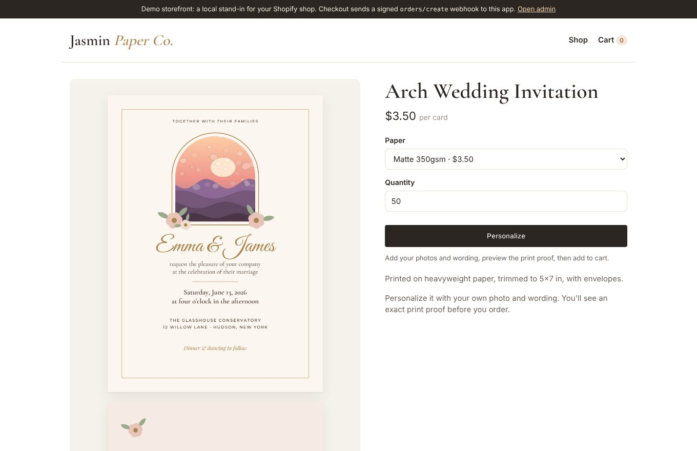
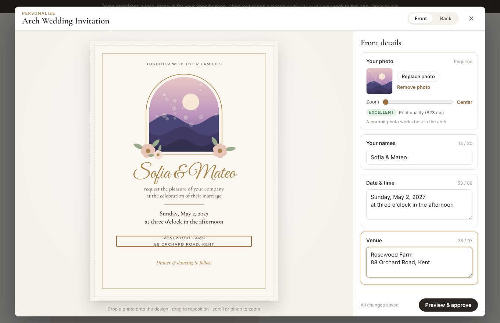
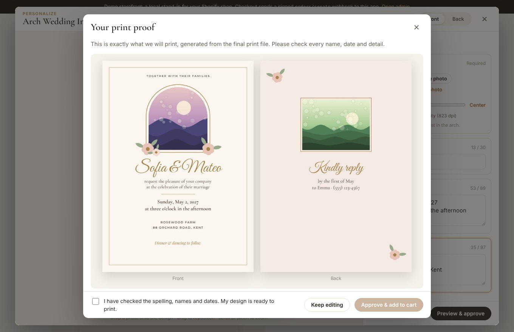
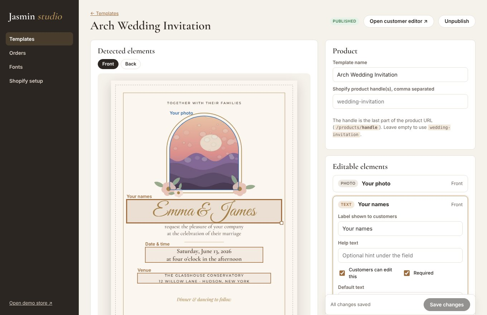
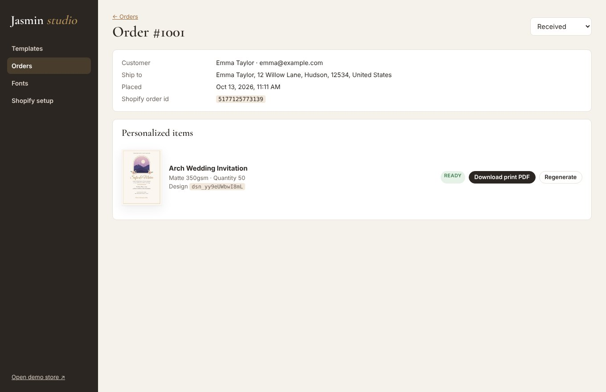

# Jasmin PDF: personalised print products for Shopify

A working prototype of a **template-driven web-to-print** system:

1. **Jasmin designs a product once** (an invitation, card, poster…) in Illustrator,
   InDesign or Affinity, puts editable things on layers named `…-customize`,
   and exports a layered PDF.
2. **The app analyses the PDF** and turns those layers into a structured template:
   photo slots (with their real clip shape) and text slots (font, size, colour,
   spacing, alignment). Jasmin reviews and tweaks it in an admin studio. No
   developer is needed per product.
3. **Customers personalise it on the Shopify product page**: drop in photos, pan
   and zoom, edit the wording. The live preview is pixel-accurate, and they
   approve an exact print proof before the item goes into the cart.
4. **The Shopify order webhook triggers a print-ready PDF**: the original
   vector artwork, with the customer's content swapped in at the right place.
   Jasmin downloads it from the admin, prints and ships.

| Product page (Shopify) | Editor | Print proof |
|---|---|---|
|  |  |  |

| Admin: template studio | Admin: order with print file |
|---|---|
|  |  |

---

## Quick start

```bash
python3 -m venv .venv && . .venv/bin/activate
pip install -r requirements-dev.txt
python -m scripts.seed                 # imports samples/wedding-invitation.pdf and publishes it
uvicorn app.asgi:app --reload          # or: uvicorn app.asgi:app --env-file .env
```

| URL | What |
|---|---|
| http://localhost:8000/demo-store | Mock Shopify storefront. Try the whole journey: personalise → cart → checkout |
| http://localhost:8000/editor/wedding-invitation | The customer editor on its own |
| http://localhost:8000/admin | Admin studio (user `admin`, password `jasmin`; change via env) |

The demo store embeds **the same snippet** you put on Shopify, keeps line item
properties in its cart, and on checkout sends an HMAC-signed `orders/create`
webhook to the real webhook endpoint. So the local flow exercises exactly
the code paths a real Shopify order does.

Sample customer photos to upload are in `samples/photos/`. `low-res.jpg`
triggers the print-quality warning.

---

## How it works

```
 Designer's layered PDF ──► Analyzer ──► Template (JSON) ──► Editor (browser) ──► Design (values)
         │                 (pdfminer)     elements, fonts,      SVG live preview         │
         │                                z-order stacks                                 │
         └─────────────────────────────────────────► Renderer (pikepdf + reportlab) ◄────┘
                                                      print-ready PDF, proofs
```

### The PDF is a design asset; the template drives the editor

Layer names alone don't say *how* something can be edited, so the analyzer
reads the PDF and produces a structured template you can review:

```jsonc
{
  "id": "couple-names", "type": "text", "layer": "couple-names-customize", "page": 0,
  "label": "Your names", "default": "Emma & James",
  "font": "GreatVibes-Regular", "fontSize": 38, "minFontSize": 22.8,
  "color": {"space": "rgb", "values": [0.659, 0.514, 0.29], "hex": "#a8834a"},
  "align": "center", "valign": "middle", "lineHeight": 1.2, "letterSpacing": 0,
  "transform": "none", "multiline": false, "maxLines": 1, "maxLength": 30,
  "autoFit": true, "required": true,
  "box": {"x": 31.68, "y": 241.66, "w": 314.64, "h": 47.58}    // points, top-left origin
}
{
  "id": "couple-photo", "type": "image", "layer": "couple-photo-customize", "page": 0,
  "box": {"x": 119, "y": 72, "w": 140, "h": 150},
  "clipPath": [["m", 119, 222], ["l", 259, 222], ["l", 259, 142], ["c", ...], ...],  // the arch
  "fit": "cover", "minDpi": 150, "required": true, "keepOriginalIfEmpty": false
}
```

### What the analyzer reads (`app/pdf/analyze.py`)
Every glyph, image and vector path is tagged with the layers (optional content
groups) it is drawn in and the clip path in effect. That covers marked
content in page streams, nested form XObjects, and `/OC` entries on XObjects.
For each `-customize` layer:

* **image inside** → photo slot. The box is the visible part of the image; the shape
  is the clip path (arches, circles, any curve).
* **text inside** → text slot. The analyzer reads the default text, font (matched
  against the font library), size, fill colour, letter spacing, line height,
  alignment and uppercase.
* **only shapes** → photo slot shaped like the shape (a "drop your photo" frame).

### Keeping the design intact (`app/pdf/engine.py`)
The engine replays the page's content stream, tracking the CTM and layer of
every painting operator, and only removes **painting** operators. Graphics-state
operators stay, so nothing else moves. The same engine produces:

* **the print file**: customizable layers are removed and the customer's content
  (a form XObject built with reportlab) is painted **at the same point in the
  paint order**. Flowers drawn over a photo stay over it, and all static artwork
  stays vector with its fonts and colour spaces untouched. Page boxes (Trim/Bleed)
  are preserved, the designer's unused placeholder images are pruned, and photos
  are cropped to the visible area and capped at 300 dpi.
* **preview slices**: the static artwork split into transparent PNGs by z-order
  (below the first element, between elements…). The editor stacks its live
  SVG elements between them.

### The preview matches the print (`app/layout.py` ⇄ `static/js/layout.js`)
Text layout (auto-shrink to fit, alignment, line spacing, letter spacing) and
photo placement (cover fit, zoom, pan, clamping, effective dpi) are implemented
once in Python and ported line by line to JavaScript. Both use the same
per-glyph advance tables shipped from the server, so they compute identical
positions (`tests/test_layout.py` runs both and compares). The browser places
every glyph explicitly in SVG, with kerning and ligatures off, just like the PDF.

---

## Preparing a template PDF (for Jasmin)

1. Put each editable item on its **own layer** and name it with `-customize`:
   `couple-photo-customize`, `couple-names-customize`, `date-customize`…
   (`name_customize`, `Name Customise` and `customize: name` also work.) All other
   layers are fixed artwork.
2. **Photos**: place a sample photo inside a clipping shape (clip group / frame).
   The clip becomes the slot shape; the sample is shown until the customer adds one.
3. **Text**: one font per layer, set in the size, colour, tracking and alignment
   you want. Multi-line text keeps its line spacing.
4. **Export** a PDF with layers and bleed. Illustrator: *Create Acrobat Layers
   from Top-Level Layers*. InDesign: *Create Acrobat Layers*. Don't outline the
   editable text.
5. Upload in **Admin → Templates**. Check the detected elements, adjust labels,
   limits and text boxes (drag them on the preview), then **Publish**.
6. **Fonts**: customer text needs the *full* font file (PDFs only embed the letters
   used). Upload `.ttf` files in **Admin → Fonts**; the PostScript name is matched
   automatically. Check the licence allows web and PDF embedding. Seven OFL fonts are
   bundled (`scripts/fetch_fonts.py`).

---

## Connecting Shopify

The integration needs no public app and no Shopify CLI: a **Custom Liquid block**
and a **notification webhook**. Admin → *Shopify setup* shows these steps with
your URLs filled in.

1. **Host the app on a public HTTPS URL** and set `APP_URL` (see `.env.example`
   and the `Dockerfile`). For testing, a tunnel works:
   `cloudflared tunnel --url http://localhost:8000`.
2. **Create the product** in Shopify as usual (price, variants for paper type,
   quantity). Link it to a template by entering the product **handle** on the
   template page, or by giving the template the same id as the handle.
3. **Add the Personalize button**: Online Store → Themes → Customize → Products →
   Default product → *Add block → Custom Liquid*, and paste the snippet from
   Admin → Shopify setup. The script:
   * asks the app whether the product has a template and shows a **Personalize**
     button, hiding the normal Add to cart / Buy now buttons;
   * opens the editor in a modal (`/editor/{template}?embed=1`). The editor allows
     framing only by `*.myshopify.com`, `SHOPIFY_SHOP_DOMAIN` and `STOREFRONT_ORIGINS`;
   * after the customer approves the proof, adds the selected variant and quantity
     with `/cart/add.js` and these **line item properties**:
     `Personalization` (visible summary), `_design_id` and `_preview` (hidden).
4. **Send orders to the app**: Settings → Notifications → Webhooks → *Create
   webhook* → *Order creation*, JSON, URL `https://YOUR-APP/webhooks/shopify/orders-create`.
   Put the signing secret shown on that page in `SHOPIFY_WEBHOOK_SECRET`.
   The webhook is HMAC-verified and idempotent (Shopify retries are safe).
   Personalised line items get a print-ready PDF, named like
   `1001-<line item>-wedding-invitation-qty75.pdf`.
5. *(Optional)* Create a custom app with `write_orders` and set
   `SHOPIFY_SHOP_DOMAIN` and `SHOPIFY_ADMIN_TOKEN`. Orders are then tagged
   `jasmin-print-ready`, `jasmin-in-production` and `jasmin-shipped` as their status
   changes in the admin.

---

## API overview

| Method & path | Purpose |
|---|---|
| `GET /api/templates/{id}` | Template for the editor (elements, z-order stacks, font metrics) |
| `POST /api/uploads` | Upload a photo (EXIF-rotated, validated; only a preview is public) |
| `POST /api/designs`, `PUT /api/designs/{id}` | Create / autosave a draft design |
| `POST /api/designs/{id}/proof` | Validate and render the exact print proof (PDF + page images) |
| `POST /api/designs/{id}/approve` | Lock the design and freeze the template version it used |
| `GET /api/storefront/products/{handle}` | Which template a Shopify product uses (CORS-open) |
| `POST /webhooks/shopify/orders-create` | Shopify order webhook (HMAC verified) |
| `/admin/api/...` | Templates, fonts (upload or Google Fonts), orders, print files, backups, accounts (Supabase sign-in, or HTTP Basic) |

Approved designs keep a snapshot of the template, so editing a template later
never changes what an existing order prints.

## Project layout

```
app/
  pdf/analyze.py     layered PDF -> template elements (pdfminer)
  pdf/engine.py      content-stream walker: strip layers, z-order slices, in-place swap (pikepdf)
  pdf/render.py      preview assets, validation, print PDF (reportlab + pikepdf + pypdfium2)
  layout.py          text fitting & photo placement (mirrored in static/js/layout.js)
  fonts.py           font library, PDF font-name matching, advance tables
  google_fonts.py    search Google Fonts and fetch a style as a TrueType file
  services.py        templates, uploads, designs, orders, housekeeping
  db.py              SQLite or Postgres behind one interface; table list, numbered migrations, transactions
  storage.py         the only code that builds paths to stored files; data directory, or Supabase Storage behind it
  jobs.py            jobs table + one worker (print files); survives a restart, retries, one job per order
  auth.py            admin sign-in (Supabase Auth) and admin accounts
  backup.py          backups (zip of database + files), daily schedule, restore
  shopify.py         webhook verification, Admin API tagging, app set-up
  config.py          settings from the environment; describe() names the modes and refuses unsafe ones
  routes/            pages, public (editor API), webhooks, admin: one router each
  main.py / asgi.py  makes the parts and puts them together
  demo_store.py      local mock storefront
static/              editor, admin studio, storefront script (vanilla JS, no build step)
extensions/          Shopify theme app extension (the Personalize button)
scripts/             seed, backup, cleanup, copy_data (SQLite + files -> Postgres + Supabase)
samples/             sample layered invitation + photos (regenerate: python samples/make_samples.py)
fonts/               bundled OFL fonts
tests/               pytest suite (+ opt-in Playwright journey)
requirements.lock    every package pinned; the image is built from it
```

Rules the code keeps to (tests check the first two):

* A file in the data directory is reached through `storage` (`path`, `writing`, `write`,
  `remove`...), never by building a path. Reading fetches it if it is only in the bucket;
  writing stores it.
* Every table is listed in `db.TABLES` (backed up, copied, locked down) or
  `db.INTERNAL_TABLES` (locked down only). A change to the database is a new entry in
  `db.MIGRATIONS`.
* Work that outlasts a request is a job (`jobs.enqueue`), not a thread.

## Tests

```bash
pip install -r requirements.lock -r requirements-dev.txt
pytest                                        # unit + API + rendering + JS/Python layout parity
JASMIN_TEST_DATABASE_URL=postgresql://... pytest   # the same suite on Postgres
JASMIN_E2E=1 pytest tests/test_e2e_browser.py # full browser journey (needs Playwright + Chromium)
```

## Prototype limitations / next steps

* **Fonts**: TrueType (`.ttf`) only. CFF-based `.otf` would need converting; one
  font per text element; no kerning or ligatures (identical in preview and print).
* **PDFs**: unrotated pages; text slots expect horizontal text. Editable text in a
  spot colour is flagged by the analyzer and set to black until you pick a colour
  (static artwork keeps its spot colours untouched).
* **Photos**: JPEG/PNG/WebP (no HEIC yet), no rotate/filters. Embedded as RGB;
  convert to the printer's CMYK profile in the RIP, or add a conversion step.
* **Infrastructure**: runs on SQLite and local disk out of the box, or on Postgres,
  Supabase Storage and Supabase Auth (see `app/config.py`). Print files are made by a
  job worker in the app's own process; proofs are still rendered inside the request
  (at most two at a time).
* **Shopify**: the Custom Liquid approach suits a single shop. To list the app or
  serve several shops, package the snippet as a theme app extension in a Shopify
  app with OAuth. A cart preview image and an "edit design" link from the cart
  would be nice additions.

## Connect a Shopify store

Jasmin studio connects to one store through a small Shopify app that belongs to that store: the
**Jasmin app**. It adds a "Personalize button" block to the theme editor, sends new orders to the
studio and lets the studio tag them. Its definition is in this repository (`shopify.app.toml` and
`extensions/jasmin-personalize/`); the store's owner creates the app and installs it once.

1. **Create the app.** Signed in as the store's owner, open the Dev Dashboard (from the store admin:
   Settings > Apps and sales channels > Develop apps), choose **Create app > Start from Dev Dashboard**
   and name it "Jasmin Studio". Under **App settings**, copy the **Client ID** and the **Client secret**.
2. **Send it its configuration and the theme block.** On a computer with Node.js, in a copy of this repository:

       npx @shopify/cli@latest app config link --client-id <Client ID>
       npx @shopify/cli@latest app deploy

   The first command signs you in to Shopify in the browser and writes the Client ID into
   `shopify.app.toml`. The second releases an app version with the settings from that file (the studio's
   address, the `read_orders` and `write_orders` permissions, the `orders/create` webhook) and the
   Personalize button block.
3. **Allow customer details in orders.** In the Dev Dashboard, open the app's **API access requests**,
   and under **Protected customer data access** select the data the print orders need (name, email,
   address). For an app used only by its own store there is no review.
4. **Install it.** On the app's page in the Dev Dashboard, choose **Install app** and pick the store.
5. **Tell the studio.** Set `SHOPIFY_SHOP_DOMAIN` (the `...myshopify.com` name), `SHOPIFY_CLIENT_ID`
   and `SHOPIFY_CLIENT_SECRET` where the studio runs, and `STOREFRONT_ORIGINS` to the shop's public
   address if it has its own domain (for example `https://www.example.com`), then restart it.
6. **Add the button.** In the studio's admin, open **Shopify setup**, press **Test the connection**, then
   **Open the theme editor and add it**, and save the theme. Link each template to its product on the
   template's page.

The app and the store must belong to the same Shopify organisation, which is the case when the store's
owner creates the app as above: only then does Shopify give the studio a token for its client id and secret.
After changing `shopify.app.toml` or the block, run `app deploy` again. The block's script is a copy of
`static/shopify/jasmin-personalize.js`; a test fails when the two differ.
